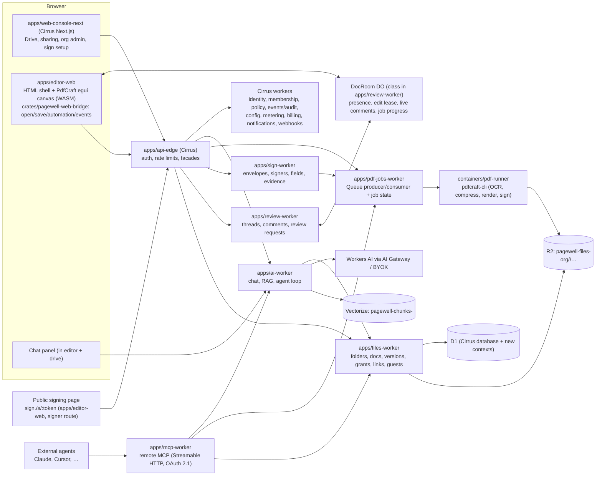

# pagewell-pdf-workspace — design

Pagewell runs entirely on one Cloudflare account. Cirrus (`cirrus-baseline
baseline-v28`) provides identity, orgs and roles (membership), policy,
events and audit, settings and flags (config), metering and quotas, Polar
billing, notifications (email), webhooks, API keys and the rate-limited
`api-edge`. Pagewell adds R2, Queues, Durable Objects, one Container, Vectorize,
Workers AI and AI Gateway, and builds on PdfCraft (`storytold/pdfcraft@v0.22.0`,
MIT OR Apache-2.0, taken under Apache-2.0) vendored at `vendor/pdfcraft/`.

## 0. Architecture



Every new worker is a Cirrus-shaped worker: service bindings from
`api-edge`, a bounded context in `packages/db` with numbered migrations, wire
types in `packages/contracts`, errors in Cirrus's shape, tests beside the
code, a `component.yaml`, and an entry in `intent.yaml`. Policy checks go
through `policy-worker`; every mutation emits a domain event through
`events-worker`, which writes the audit log.

### 0.1 The editor in the browser

- `crates/pagewell-web-bridge` is a new wasm entry crate that depends on
  `pdfcraft-ui-egui` and mounts the egui canvas into a host page. PdfCraft
  v0.22.0 already ships a host mode (`craft-web-host`, `data-host="page"`)
  with open-bytes (`startup_inbox`), a host save function and a dirty
  function; the bridge uses that host mode, so no upstream patch is
  expected for open and save. It exposes to JS through `wasm-bindgen`:
  `open(bytes, {name, readOnly})`, `save() → bytes`, `isDirty()`,
  `automation(call) → result` (PdfCraft's `Automation::call`, the same API its
  MCP server uses), and the events `dirty`, `page`, `selection`,
  `annotationChanged` and `error`.
- `apps/editor-web` serves `/edit/:docId` and `/edit/local` as top-level,
  same-origin pages through Workers Static Assets, with COOP/COEP headers if
  the wasm build uses threads. The HTML shell (top bar, comments, activity,
  chat) is React, using the console's components.
- `/edit/local` opens a file from disk with no account and uploads nothing;
  "Save to Pagewell" asks the user to sign in.
- Budgets (gated in PW1): ≤ 8 MB compressed wasm + assets on first load,
  cached immutably by content hash; a 100-page fixture shows its first page in
  ≤ 2 s on a mid-range laptop in Chromium. Measured numbers go in the ledger;
  a miss becomes a risk entry, never a silently raised budget.

## 1. The resource

New bounded contexts in `packages/db` (D1). Every table has `org_id`,
`created_at` and `updated_at`; soft deletes where noted. Ids use Cirrus's id
helper (`packages/db/src/ids`) with these prefixes:

| Prefix | Object | Prefix | Object |
|---|---|---|---|
| `fld_` | folder | `thr_` | comment thread |
| `doc_` | document | `cmt_` | comment |
| `grt_` | grant | `rvr_` | review request |
| `lnk_` | share link | `env_` | signature envelope |
| `gst_` | guest | `sgn_` | signer |
| `job_` | job | `fdl_` | envelope field |
| `cnv_` | AI conversation | `spc_` | space |
| `upl_` | multipart upload | `pky_` | BYOK provider key |

```
files.folders        id fld_, org_id, parent_id (null = org root), name, deleted_at
files.documents      id doc_, org_id, folder_id, name, current_version, page_count, size,
                     owner_user_id, deleted_at
files.versions       org_id, doc_id, version, r2_key, sha256, size, created_by,
                     actor_kind (user|agent|mcp|api|sign), provenance_json
                     UNIQUE (doc_id, version)
files.grants         id grt_, org_id, resource_kind (folder|document), resource_id,
                     principal_kind (member|guest), principal_id, role (editor|commenter|viewer)
files.links          id lnk_, org_id, resource_kind, resource_id, role (viewer|commenter),
                     token_hash, password_hash, expires_at, allow_download, revoked_at
files.link_opens     org_id, link_id, opened_at, ip_hash, ua_hash
files.guests         id gst_, org_id, email, name, verified_at
files.uploads        id upl_, org_id, doc_id?, r2_upload_id, parts_json, expires_at
review.threads       id thr_, org_id, doc_id, anchor_json, version, status (open|resolved|outdated)
review.comments      id cmt_, org_id, thread_id, author_kind, author_id, body, mentions_json,
                     edited_at, deleted_at
review.requests      id rvr_, org_id, doc_id, due_at, message
review.request_reviewers  org_id, request_id, principal_kind, principal_id, decision, decided_at
sign.envelopes       id env_, org_id, status (draft|sent|completed|declined|expired|voided),
                     order_mode (parallel|sequential), expires_at, completed_version_ref
sign.envelope_documents  org_id, envelope_id, doc_id, version (frozen at send)
sign.signers         id sgn_, org_id, envelope_id, name, email, order, status, token_hash
sign.fields          id fdl_, org_id, envelope_id, signer_id, doc_id, page, rect_json, kind, value_ref
sign.events          org_id, envelope_id, seq, kind, payload_json, prev_hash, hash   (append-only)
jobs.jobs            id job_, org_id, kind, input_json, output_json, status, error, actor_kind,
                     started_at, finished_at
ai.conversations     id cnv_, org_id, user_id, doc_id?, scope, retention_until
ai.messages          org_id, conversation_id, seq, role, body_ref
ai.tool_calls        org_id, conversation_id, seq, tool, args_json, result_json, executor, confirmed_by
ai.chunks            org_id, doc_id, version, page, chunk_no, vector_id
ai.provider_keys     id pky_, org_id, provider, encrypted_key, enabled_by, enabled_at
spaces.spaces        id spc_, org_id, name, assistant_prompt, summary
spaces.items         org_id, space_id, doc_id
spaces.views         org_id, space_id, viewer_kind, viewer_id, viewed_at
```

D1 has no interactive transactions: multi-statement writes use `batch()`,
every mutating route takes an `Idempotency-Key` (Cirrus's
`api-edge/src/idempotency.ts`), version numbers come from a unique constraint
plus retry, and deletes are soft with a 30-day trash.

**R2 layout** (bucket `pagewell-files-<env>`, never public):

```
org/<orgId>/doc/<docId>/blob/<blobId>.pdf      (a version's bytes; a fresh id per write, D9)
org/<orgId>/doc/<docId>/thumb/<version>/<page>.webp
org/<orgId>/doc/<docId>/text/<version>.json
org/<orgId>/tmp/<uploadId>
org/<orgId>/jobs/<jobId>/{in,out}/…
org/<orgId>/sign/<envelopeId>/…
```

Every R2 key is built by one helper in `packages/shared` that takes the org id
first; a lint rule forbids building R2 keys anywhere else.

**Permissions.** Cirrus org roles (owner, admin, member, viewer) set the
floor. Grants on folders or documents add `editor`, `commenter` or `viewer`;
folder grants inherit downward and the most permissive applies; there is no
explicit `none`. Links carry `viewer` or `commenter` only, never `editor`.
Guests see only what they were granted. Every check goes through
`policy-worker`, which gains a `files` resource kind.

**Versions and the edit lease.** A save is a whole file posted with
`baseVersion`; a stale base gets `409 version_conflict`. `DocRoom` grants a
renewable edit lease to one session; others open read-only and can still
comment; an admin can break a lease. Version 1 (the original upload) is never
garbage-collected.

## 2. The API

All routes go through `api-edge` facades with Cirrus's `{ data, meta }`
envelope, error shape, cursor pagination, rate limits and idempotency.

```
GET|POST   /v1/orgs/{org}/folders                     files-worker
GET|PATCH|DELETE /v1/orgs/{org}/folders/{fld}
GET|POST   /v1/orgs/{org}/documents                   (POST = upload; multipart for large files)
GET|PATCH|DELETE /v1/orgs/{org}/documents/{doc}
GET|POST   /v1/orgs/{org}/documents/{doc}/versions    (POST = save with baseVersion → 409 version_conflict)
POST       /v1/orgs/{org}/documents/{doc}/versions/{n}/restore
GET        /v1/orgs/{org}/documents/{doc}/content?version=   (streamed)
GET|POST|DELETE /v1/orgs/{org}/documents/{doc}/grants   (and /folders/{fld}/grants)
GET|POST|DELETE /v1/orgs/{org}/documents/{doc}/links
GET        /v1/l/{token}                               (link open; password and email code steps)
GET|POST   /v1/orgs/{org}/documents/{doc}/threads      review-worker
POST       /v1/orgs/{org}/threads/{thr}/comments
GET|POST   /v1/orgs/{org}/documents/{doc}/review-requests
GET|POST   /v1/orgs/{org}/envelopes                    sign-worker
POST       /v1/orgs/{org}/envelopes/{env}/send|void|resend
GET|POST   /v1/s/{token}                               (public signing)
GET|POST   /v1/orgs/{org}/jobs                         pdf-jobs-worker
POST       /v1/orgs/{org}/chat                         ai-worker (SSE)
GET        /v1/orgs/{org}/search
GET        /v1/rooms/{doc}                             WebSocket → DocRoom
POST       /mcp                                        mcp-worker (Streamable HTTP)
/api/v1/*                                              public API, Cirrus API keys
```

Error codes added: `version_conflict` (409), `lease_held` (409),
`quota_exceeded` (402, from metering), `link_expired` / `link_revoked` (404,
so a dead link reveals nothing), `confirmation_required` (428, MCP and agent
destructive steps). A resource in another org is always `404 not_found`,
never 403.

### 2.1 The tool surface

`pdf-tools.json` (generated by `pdfcraft-cli tools` at the pinned ref) holds
the PDF tools. `packages/agent-tools` adds the drive tools: `drive.search`,
`drive.list`, `doc.get`, `doc.upload`, `doc.versions`, `doc.share`,
`comment.list`, `comment.add`, `sign.request`, `job.status`. The schema of a
tool is the same everywhere; the executor differs:

| Executor | Runs | Used by |
|---|---|---|
| Browser | `Automation::call` in the editor's wasm on the open document; edits are live and undoable | in-editor chat |
| Container | `pdfcraft-cli` in `pdf-runner` on a stored version; the result is a new version | MCP, `/api/v1`, chat with no editor open |
| Worker | `files-worker`, `review-worker`, `sign-worker`, `ai-worker` | drive tools, from every surface |

`mcp-worker` serves MCP over Streamable HTTP at `https://app.<domain>/mcp`.
OAuth 2.1 with Cirrus identity as the authorization server
(`workers-oauth-provider`), plus Cirrus API keys for headless agents. A
session is bound to one org and one user; every call is checked against that
user's role and grants, metered, rate-limited and audited with
`actor: agent:<client name>`. Compact mode, as in `pdfcraft-cli mcp
--compact`: about ten core tools plus `tool_search` and `tool_call`.
Destructive tools (`doc.delete`, redaction apply, `sign.request`, share
changes) answer `confirmation_required` unless the org turned confirmations
off for that API key.

Outbound webhooks (Cirrus `webhooks-worker`, signed): `document.created`,
`version.created`, `comment.created`, `envelope.completed`, `job.finished`.

### 2.2 Heavy jobs

`containers/pdf-runner` is built in CI from `vendor/pdfcraft` at the pinned
ref: `pdfcraft-cli` plus Tesseract (Latin first), behind one route `POST /run`
taking `{operation, inputs: [r2 keys], options}` and returning output keys.
Each job gets a fresh directory; every `pdfcraft-cli` call runs with
`--root <jobdir>`; the job has no network except R2 through the wrapper; CPU,
memory and page limits come from the plan. Operations: OCR, compress, merge,
split, extract pages, rotate, flatten forms, redact (apply), sanitize, render
pages and thumbnails, extract text, sign, print-ready PDF. Flow: `api-edge` →
`pdf-jobs-worker` writes `jobs.jobs` and enqueues → consumer calls the
container → output becomes a version or a document → event and notification;
progress streams through `DocRoom`. Light operations the editor already does
(reorder, rotate, delete pages, fill forms, comment) stay in the browser.

### 2.3 E-signature

An envelope holds documents (versions frozen at send), signers in parallel or
sequential order, fields per signer (signature, initials, date, text,
checkbox), a message, an expiry and reminders. Each signer gets a single-use
expiring link to `sign.<domain>/s/:token` and verifies with an email one-time
code. On completion `pdf-jobs-worker` flattens the fields, appends a
certificate page (signers, emails, IPs, timestamps, document hash before and
after) and applies a PAdES-B-B platform signature with a Pagewell certificate
held as a Worker secret or in Secrets Store. Envelope events are append-only
with hashes chained per envelope. This is a simple electronic signature with
an audit trail; the product says so on pricing and help pages.

### 2.4 Chat

Ask: page-chunked text embedded into Vectorize with metadata
`{orgId, docId, version, page}`; every query filters `orgId` and the
caller's readable `docId`s; answers cite pages; a citation jumps to the page
and highlights the quote. Act: the same loop with tools; in the editor,
mutating PDF tools run in the browser executor; outside it, in the container.
Retrieved text is passed as delimited data; share, delete, redact and send
steps always show a confirm card. Models: Workers AI through AI Gateway by
default; BYOK keys encrypted with a per-org data key in Cirrus config.
Every agent-made version records the conversation id and tool calls.

## 3. The console

Uses the Cirrus console's design system; light and dark; WCAG 2.2 AA on every
HTML surface (axe in CI). The egui canvas is a tracked gap (PW-J).

1. **Drive** `/o/:org/drive/:folder?`: left rail (My files, Shared with me,
   Recent, Starred, Trash, Spaces, Envelopes, Settings); breadcrumb, Upload,
   New folder, search, grid/list with thumbnails; drag-and-drop upload with a
   progress tray; row menu (Open, Share, Rename, Move, Make a copy, Download,
   Versions, Request signature, Ask AI, Delete); empty state with "Try with a
   sample PDF".
2. **Editor** `/edit/:docId`: 48 px top bar (back, inline rename, version and
   save state, presence, lease indicator, Share, Request signature, Ask AI,
   overflow: Download, Download with comments, Print, Version history, Run
   job); PdfCraft's canvas full-bleed; right sidebar tabs Comments, Activity,
   Chat; `⌘S`, `⌘K` (PdfCraft's palette), `⌘J`.
3. **Share dialog**: people and groups with role; who has access, with
   inherited source; link toggle, role, expiry, password, allow download,
   copy; notify with message.
4. **Version history**: timeline with author or agent badge, size, what
   changed; View, Restore as new version, Download, Compare.
5. **Chat panel**: streaming; citation chips; tool cards with Undo; confirm
   cards; scope switcher (this document / folder / all mine); model in the
   footer.
6. **Envelope builder**: recipients and order; place fields per signer;
   message, expiry, reminders; envelope page with per-signer status, events,
   Resend, Void, Download.
7. **Public signing page** `sign.<domain>/s/:token`: no app chrome, guided
   fields, adopt signature (type, draw, upload), confirmation with download;
   fully usable at 390 px.
8. **Org settings**: members and roles (Cirrus), guests, sharing policy, AI
   (enable, providers, BYOK, retention), MCP and API (keys, OAuth clients,
   confirmation policy), storage and usage, billing (Polar), audit log.
9. **MCP page** `/o/:org/settings/mcp`: server URL, copy-paste config for
   Claude and Cursor, connected clients, tool list.
10. **Marketing**: landing, pricing (generous free tier, quotas stated),
    "Open a PDF without an account" → `/edit/local`, MCP page, a factual
    Acrobat comparison using the name only nominatively.

## 4. Events, secrets, and integrations

- **Cloudflare resources** (all on the `nexo` connection, declared in
  `intent.yaml` and Terraform like Cirrus's): R2 bucket per env, Queues
  `pagewell-jobs-<env>`, Durable Object `DocRoom`, Container `pdf-runner`,
  Vectorize index per env, Workers AI binding, AI Gateway per env.
- **Domain events** (Cirrus `events-worker`, which feeds audit and
  webhooks): `folder.*`, `document.created|renamed|moved|deleted|restored`,
  `version.created|restored`, `grant.*`, `link.created|opened|revoked`,
  `guest.invited|verified`, `thread.*`, `comment.*`, `review_request.*`,
  `envelope.*`, `job.*`, `agent.tool_called`, `mcp.session_started`.
- **Secrets** (brokered through Orunbase, never in the repo): the platform
  signing key and certificate, the OAuth signing key for `mcp-worker`, the
  per-org data-key wrapping key, the link and signer token pepper. BYOK model
  keys are encrypted data, not deploy secrets.
- **Email** through Cirrus `notifications-worker`: share invites, email codes,
  mentions, review reminders (Cron Trigger), signature requests and completed
  envelopes.
- **Metering** (Cirrus `metering-worker`): storage bytes, versions kept,
  container seconds, pages OCR'd, AI tokens, MCP calls, envelopes sent; each
  has a plan quota.
- **Content safety**: no document text, extracted text, prompts or completions
  logged at info; content debug logging is off in stage and prod; fixtures are
  generated (`cargo xtask demo-pdf`), never real documents.

## 5. Out of scope

Real-time co-editing of one page by two people (the edit lease replaces it);
editing existing text beyond what the engine does; qualified or advanced
electronic signatures, TSA timestamps and long-term validation; desktop and
mobile apps; a self-hosted edition; phone-camera scanning; any content leaving
Cloudflare except to a BYOK provider an org admin turned on. OCR beyond Latin
script is deferred to upstream. Office → PDF is optional in PW11 and may be
deferred with a reason.
